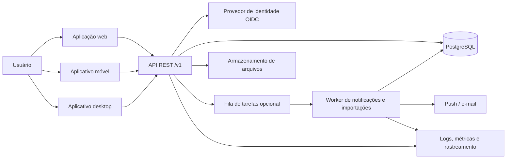
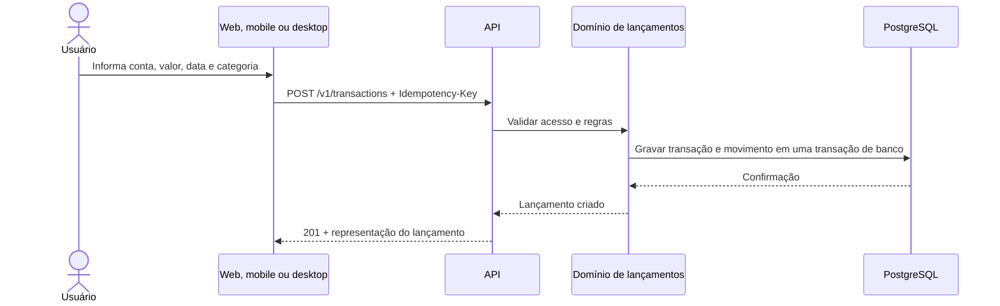

# Arquitetura proposta

## Decisão principal

Adotar um **monólito modular** no backend, uma API única e clientes web, mobile e desktop independentes.

Essa abordagem reduz o custo operacional e a complexidade do primeiro lançamento sem transformar o sistema em um bloco indivisível. Cada área de negócio terá seu próprio módulo, serviços e acesso controlado aos dados. A separação em microserviços só deverá ocorrer quando escala, segurança, cadência de entrega ou isolamento de falhas justificarem o custo.

## Visão de contexto



O armazenamento de arquivos, a fila e o worker entram somente nas fases que exigirem comprovantes, importações pesadas ou notificações assíncronas.

## Componentes

### Aplicação web

Responsável por dashboards, cadastros, planejamento, importações e relatórios. Consome a API pública do produto; não mantém uma segunda implementação das regras financeiras.

### Aplicativo móvel

Responsável por registro rápido, consulta, notificações e uso das capacidades do aparelho. Tokens de sessão devem ficar no armazenamento seguro do sistema operacional. Cache local não é a fonte oficial dos dados.

### Aplicativo desktop

Responsável por uma experiência instalada e otimizada para teclado, telas grandes, importação/exportação de arquivos e notificações do sistema. Usa Tauri como invólucro nativo e React/TypeScript na interface. A camada Rust deve ser pequena, auditável e limitada a capacidades locais autorizadas. O desktop consome a mesma API e nunca acessa diretamente o PostgreSQL.

### API

É a porta de entrada para regras de negócio e dados. Suas responsabilidades incluem:

- autenticar e autorizar requisições;
- validar comandos;
- executar regras e invariantes financeiras;
- controlar transações no banco;
- fornecer consultas paginadas e filtradas;
- publicar o contrato OpenAPI;
- emitir eventos internos após confirmações no banco;
- registrar auditoria e telemetria.

### Worker

Executa atividades que não precisam terminar dentro da requisição original, como envio de notificações, processamento de importações, geração de relatórios grandes e criação antecipada de ocorrências recorrentes. Deve ser idempotente e usar a mesma camada de domínio do backend.

### Banco de dados

O PostgreSQL é a fonte oficial para identidades internas, espaços financeiros, contas, lançamentos, planejamentos e auditoria. Alterações de esquema são feitas somente por migrações versionadas.

## Módulos de negócio

| Módulo | Responsabilidade principal |
|---|---|
| Identidade e acesso | Perfil local, vínculo com o provedor de identidade, sessões e permissões |
| Espaços financeiros | Ambiente individual ou familiar, membros, convites e papéis |
| Contas | Conta corrente, poupança, carteira, dinheiro e saldos iniciais |
| Cartões e faturas | Cartões, limites, ciclos, fechamento, vencimento e pagamento de faturas |
| Lançamentos | Receitas, despesas, transferências, ajustes, estornos e anexos |
| Categorias | Categorias, subcategorias, etiquetas e regras de classificação |
| Parcelamentos | Compra, quantidade de parcelas, distribuição de centavos e vínculo com faturas |
| Recorrências | Regras, próximas ocorrências, pausas, exceções e encerramento |
| Planejamento | Compromissos futuros, projeção de saldo e cenários |
| Orçamentos | Limites por período e categoria, consumo e alertas |
| Metas | Objetivo, valor-alvo, prazo, contribuições e progresso |
| Relatórios | Visões agregadas por período, conta, categoria e situação |
| Importação e exportação | CSV/OFX, prévia, mapeamento, deduplicação e portabilidade |
| Notificações | Preferências, agendamento, entrega e histórico |
| Auditoria | Histórico de ações relevantes sem armazenar segredos |

Cada módulo pode ler seus próprios dados e expõe operações para os demais módulos. Acesso direto às tabelas de outro módulo deve ser evitado na camada de aplicação.

## Fluxos importantes

### Registro de uma despesa



Uma repetição da mesma requisição com a mesma chave de idempotência deve devolver o mesmo resultado, evitando duplicidade em redes móveis instáveis.

### Compra parcelada

1. O usuário informa valor total, data, número de parcelas e conta ou cartão.
2. O domínio cria a compra e o plano de parcelamento.
3. O valor é distribuído em parcelas; eventuais centavos restantes são alocados de forma determinística.
4. Parcelas futuras são obrigações previstas, não despesas realizadas na conta de pagamento.
5. Em cartão, cada parcela é associada à fatura correta conforme data de compra, fechamento e vencimento.
6. Cancelamento ou estorno cria eventos compensatórios e preserva o histórico.

### Recorrência

A regra de recorrência é um modelo. Cada ocorrência gerada possui identidade própria e pode ser confirmada, alterada ou ignorada sem reescrever ocorrências anteriores.

## Contrato da API

- REST sobre HTTPS e JSON.
- Prefixo versionado: `/v1`.
- Especificação OpenAPI gerada e validada no pipeline.
- Datas civis no formato `YYYY-MM-DD`; instantes em UTC no formato ISO 8601.
- Valores monetários trafegados como texto decimal ou inteiro em unidade mínima, nunca como ponto flutuante.
- Paginação por cursor para históricos extensos.
- `Idempotency-Key` em criações financeiras e importações.
- Erros no formato Problem Details, com código estável, mensagem segura e identificador de correlação.
- Filtros e ordenações permitidos definidos explicitamente; nenhuma consulta arbitrária vinda do cliente.

## Consistência e eventos

Operações que afetam saldos, parcelas ou faturas devem ser atômicas no PostgreSQL. Se um evento precisar ser enviado a uma fila, deve ser gravado em uma tabela de saída (`outbox`) na mesma transação e publicado posteriormente pelo worker. Isso evita confirmar o dado e perder o evento.

Relatórios simples podem consultar o banco transacional. Agregações caras devem usar tabelas de resumo ou projeções atualizadas por eventos internos, sem criar outro banco prematuramente.

## Estrutura sugerida do repositório

```text
apps/
  api/              API NestJS
  web/              Aplicação Next.js
  mobile/           Aplicativo Expo/React Native
  desktop/          Aplicativo Tauri + React/TypeScript
  worker/           Processos assíncronos, quando necessários
packages/
  api-contracts/    Tipos gerados a partir do OpenAPI
  validation/       Schemas compartilháveis sem regra de domínio
  design-tokens/    Cores, tipografia, espaçamentos e ícones
  desktop-ui/       Componentes desktop reutilizáveis, se houver demanda
  config/           Configurações comuns de lint e TypeScript
infra/
  containers/       Arquivos para ambiente local e imagens
  deployment/       Definições de implantação por ambiente
doc/                Documentação e decisões
```

Regras financeiras não devem ser colocadas em `packages` para serem executadas no cliente. O backend é a autoridade; clientes podem repetir validações apenas para melhorar a experiência.

## Implantação inicial

Ambientes separados de desenvolvimento, homologação e produção, com:

- aplicação web em contêiner ou plataforma compatível com Node.js;
- API e worker em contêineres independentes;
- PostgreSQL gerenciado sempre que possível;
- armazenamento de objetos compatível com S3 quando anexos forem habilitados;
- Redis somente quando filas, cache distribuído ou limitação distribuída justificarem;
- segredos em cofre do provedor, nunca no repositório;
- migração de banco executada como etapa controlada da entrega;
- backup e teste periódico de restauração.

O aplicativo desktop terá pipeline próprio por sistema operacional, instaladores assinados e canal de atualização com artefatos verificados. Os detalhes estão em [Aplicativo desktop](./08-aplicativo-desktop.md).

## Quando considerar microserviços

A separação física de um módulo só será considerada quando existir ao menos um motivador mensurável, por exemplo:

- volume de importações prejudicando as operações interativas;
- requisitos de segurança ou conformidade diferentes;
- necessidade comprovada de escalar um módulo de forma independente;
- equipe autônoma responsável por um contexto bem delimitado;
- janela de implantação ou disponibilidade incompatível com o restante do sistema.

Até lá, os limites modulares oferecem a maior parte do benefício com menor custo.
