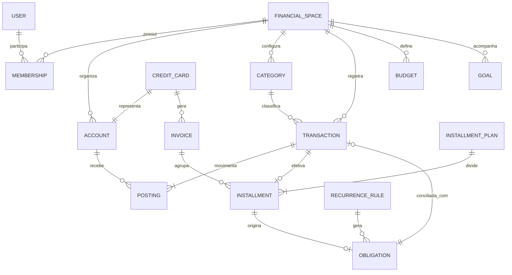

# Modelo de domínio e dados

## Objetivo do modelo

O modelo deve manter o histórico financeiro correto e, ao mesmo tempo, representar intenções futuras. Para isso, separa:

- **movimentação efetiva:** alterou ou confirmou o saldo de uma conta;
- **obrigação:** valor devido ou esperado em uma data, como parcela e conta a pagar;
- **previsão:** hipótese usada em planejamento;
- **regra:** modelo que gera ocorrências, como uma recorrência;
- **agregação:** fatura, orçamento ou relatório calculado a partir dos itens anteriores.

## Visão conceitual



O diagrama é conceitual. Nomes físicos e cardinalidades finais devem ser confirmados durante o desenho do esquema.

## Agregados principais

### Espaço financeiro

Fronteira de isolamento dos dados. Todo registro financeiro pertence a exatamente um espaço. Uma associação liga o usuário ao espaço e define seu papel.

Campos essenciais:

- identificador;
- nome;
- moeda principal;
- fuso horário;
- estado;
- datas de criação e atualização.

### Conta

Representa onde existe saldo: conta corrente, poupança, dinheiro ou outra carteira. Cartão de crédito possui uma conta técnica associada, mas suas compras são organizadas por fatura.

O saldo não deve ser um número livremente editável. Ele é derivado do saldo inicial e dos movimentos confirmados. Um ajuste cria um lançamento identificável.

### Transação e movimento

`Transaction` representa o evento compreendido pelo usuário. `Posting` representa o efeito assinado em cada conta.

Exemplos:

- receita de R$ 100: um movimento de `+100,00` na conta;
- despesa de R$ 40: um movimento de `-40,00` na conta;
- transferência de R$ 250: `-250,00` na origem e `+250,00` no destino, dentro da mesma transação;
- ajuste: um movimento com motivo obrigatório e auditoria.

Transferências internas devem somar zero na mesma moeda. Taxas de transferência são despesas separadas, embora possam pertencer ao mesmo agrupamento visual.

### Obrigação

Representa algo esperado, devido ou a receber. Pode vir de uma recorrência, parcela, planejamento manual ou importação. Sua situação pode ser:

- prevista;
- pendente;
- parcialmente conciliada;
- conciliada;
- vencida;
- ignorada;
- cancelada.

Quando confirmada, é vinculada a uma transação efetiva. A obrigação não deve ser silenciosamente transformada em saldo realizado.

### Plano de parcelamento e parcela

O plano mantém o valor total, quantidade, regra de distribuição, data inicial e origem. Cada parcela tem sequência, valor, vencimento e situação próprios.

Invariantes:

- a soma das parcelas é igual ao valor total;
- sequências são únicas e contínuas dentro do plano;
- uma parcela pertence a no máximo uma fatura por vez;
- alterações não reescrevem parcelas já conciliadas sem uma operação explícita;
- estorno preserva a ligação com a compra original.

### Cartão e fatura

O cartão define limite, conta associada, fechamento e vencimento. A fatura representa um ciclo e agrega compras, parcelas, encargos, créditos e pagamentos.

O pagamento da fatura é uma transferência da conta pagadora para a conta do cartão. As compras já constituem despesas; o pagamento não pode contabilizá-las novamente.

### Regra de recorrência

Armazena frequência, intervalo, data inicial, término, timezone e modelo de valor/classificação. A regra gera obrigações com antecedência limitada. Exceções pertencem à ocorrência, não reescrevem o histórico da regra.

### Orçamento

Define limite para período e, opcionalmente, categoria. O consumo deve distinguir:

- realizado;
- comprometido;
- projetado;
- disponível.

A definição de qual situação entra no indicador padrão deve ser visível ao usuário.

### Meta

Armazena valor-alvo, prazo e contribuições vinculadas. Uma meta não bloqueia dinheiro automaticamente no MVP; ela oferece acompanhamento. Reserva efetiva de saldo pode ser uma evolução.

## Tipos de dados financeiros

- Valores: `numeric(19,4)` no banco ou precisão equivalente definida pela moeda.
- Código de moeda: ISO 4217, mesmo que inicialmente apenas BRL.
- Arredondamento: regra explícita por operação; nunca depender do padrão da linguagem.
- Datas de competência e vencimento: tipo `date`.
- Instantes de criação, confirmação e auditoria: `timestamptz`, armazenados em UTC.
- Identificadores: UUID ou identificador ordenável equivalente, sem significado de negócio.
- Exclusão: lógica para registros referenciados; física somente por processo controlado de privacidade e retenção.

## Concorrência e idempotência

- Entidades financeiras mutáveis possuem versão para concorrência otimista.
- Comandos de criação aceitam uma chave de idempotência por cliente e espaço.
- A resposta original é reutilizada em repetições equivalentes.
- A mesma chave com conteúdo diferente é rejeitada.
- Importações usam identificador de lote e impressão digital da linha normalizada.
- Jobs usam chave natural da ocorrência, impedindo geração dupla.

## Cálculos essenciais

### Saldo realizado

```text
saldo realizado = saldo inicial + soma dos movimentos confirmados até a data
```

### Saldo projetado

```text
saldo projetado = saldo realizado
                + receitas previstas no horizonte
                - despesas e obrigações previstas no horizonte
```

Transferências entre contas incluídas no mesmo consolidado não alteram o total consolidado.

### Limite disponível do cartão

```text
limite disponível = limite concedido - compras que consomem limite + liberações confirmadas
```

A política exata de liberação após pagamento ou estorno deve ser configurável e testada, pois pode variar por emissor.

## Auditoria

Eventos auditáveis incluem:

- criação, edição, cancelamento e estorno de lançamento;
- alteração de saldo inicial;
- mudança de papel ou acesso;
- importação e desfazimento de lote;
- exportação ou exclusão de dados;
- mudança de fechamento, vencimento ou limite de cartão;
- alteração retroativa em recorrência ou parcelamento.

A auditoria registra autor, instante, operação, entidade, identificador de correlação e resumo seguro da mudança. Não registra senha, token, número completo de cartão nem conteúdo desnecessário de comprovante.

## Índices iniciais sugeridos

- transações por `financial_space_id`, data de competência e situação;
- movimentos por `account_id` e data efetiva;
- obrigações por espaço, vencimento e situação;
- parcelas por plano e sequência;
- faturas por cartão, início e fim do ciclo;
- categorias por espaço, tipo e estado;
- idempotência por espaço, cliente e chave;
- outbox por situação e próxima tentativa;
- auditoria por espaço, entidade e instante.

Os índices finais devem ser confirmados com planos de execução e carga representativa, não apenas por intuição.
