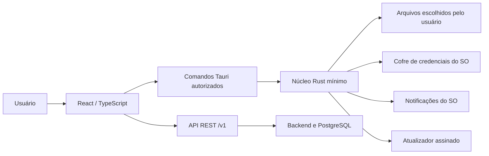

# Aplicativo desktop

## Objetivo

Oferecer uma versão instalada do sistema de controle financeiro, adequada ao uso prolongado em computador e integrada de forma segura ao sistema operacional. O desktop não será apenas um atalho para o site: terá navegação por teclado, importação e exportação nativas, notificações locais e ciclo próprio de instalação e atualização.

## Decisão técnica

Adotar **Tauri 2 + React + TypeScript + Vite**.

- React/TypeScript implementa a interface.
- Vite gera os ativos locais carregados na WebView.
- Tauri gerencia janela, ciclo de vida, capacidades, instalador e atualização.
- Rust implementa apenas comandos que precisam acessar recursos nativos.
- A API NestJS continua sendo a autoridade de autenticação, autorização, regras financeiras e persistência.

A aplicação desktop não executará o servidor Next.js e não acessará diretamente o PostgreSQL. Isso evita uma segunda arquitetura de backend dentro do computador e mantém o contrato consistente entre todos os clientes.

## Plataformas

O alvo técnico é:

- Windows;
- macOS;
- Linux.

Para controlar custo de testes, assinatura e suporte, a liberação pode ser escalonada. A proposta inicial é lançar primeiro para Windows, coerente com o ambiente atual do projeto, e homologar macOS e distribuições Linux selecionadas em seguida. Essa ordem é uma premissa e precisa de aprovação de produto.

“Compatível com Tauri” não significa automaticamente “suportado pelo produto”. A matriz oficial deverá indicar sistema, arquitetura, versão mínima, formato do instalador e canal de suporte.

### Matriz oficial de plataformas

A matriz abaixo é a fonte de verdade do que o produto suporta. Cada linha corresponde a um job de build no sistema operacional nativo (ver “Pipeline de release”).

| Sistema | Arquitetura | Versão mínima | Formatos | Canal de suporte |
|---|---|---|---|---|
| Windows | x86_64 | Windows 10 | MSI e NSIS | Download direto |
| macOS | universal (x86_64 + arm64) | macOS 10.15 | DMG (`.app` incluso) | Download direto |
| Linux | x86_64 | Ubuntu 22.04 (glibc 2.35+) | AppImage e Debian (`.deb`) | Download direto |

Notas:

- Windows foi o primeiro alvo entregue (instaladores MSI/NSIS validados); esta matriz consolida e formaliza o suporte a macOS e Linux.
- macOS é empacotado como binário **universal**, cobrindo Macs Intel e Apple Silicon em um único artefato.
- Linux usa `ubuntu-22.04` como base de build; o `.deb` declara `libwebkit2gtk-4.1-0` e `libgtk-3-0` como dependências, e o AppImage embute o media framework.
- A distribuição é por **download direto** enquanto não houver loja ou repositório próprios. Assinatura e notarização seguem a seção “Assinatura de release”.

## Arquitetura

### Limites

- A interface não chama comandos nativos genéricos de shell.
- O núcleo Rust não calcula saldo, parcela, fatura ou orçamento.
- O desktop não recebe credencial do banco.
- Arquivos só são lidos ou gravados após ação explícita do usuário.
- Conteúdo remoto não é carregado dentro de uma WebView com capacidades privilegiadas.
- Toda gravação financeira usa a API e chave de idempotência.

## Compartilhamento de código

O desktop pode compartilhar:

- cliente gerado pelo contrato OpenAPI;
- tipos e schemas de entrada sem regra de domínio;
- design tokens, ícones e formatação;
- componentes React que não dependam de Next.js nem de APIs específicas do navegador;
- telemetria e tratamento padronizado de erros.

Não deve compartilhar automaticamente:

- Server Components, Server Actions ou roteamento do Next.js;
- componentes móveis React Native;
- regras financeiras autoritativas;
- código que pressuponha acesso irrestrito ao sistema de arquivos;
- armazenamento de sessão entre processos ou plataformas.

A extração de um pacote de componentes só deve ocorrer quando houver reutilização real. Duplicar uma pequena composição visual pode ser mais seguro do que criar uma abstração inadequada.

## Experiência proposta

### Navegação

- menu lateral para dashboard, lançamentos, contas, cartões, planejamento e relatórios;
- atalhos para novo lançamento, pesquisa, troca de período e importação;
- foco visível e ordem de tabulação previsível;
- restauração segura de tamanho e posição da janela;
- confirmação antes de fechar quando existir trabalho local não enviado.

### Recursos locais

- seletor nativo para importar CSV/OFX;
- seletor de pasta ou arquivo para exportações;
- notificações de vencimento, orçamento e atualização;
- integração opcional com bandeja do sistema após validação;
- abertura de links externos no navegador padrão;
- cache de leitura protegido, se necessário.

### Paridade

O MVP desktop deve cobrir os mesmos fluxos financeiros essenciais da web. Recursos locais aprimoram o fluxo, mas não criam entidades exclusivas que impeçam o uso da conta por outro cliente.

## Autenticação

Fluxo recomendado:

1. O desktop gera `state`, verificador PKCE e desafio.
2. Abre a autorização no navegador padrão.
3. O provedor autentica o usuário.
4. O retorno chega por URI registrada ou servidor local temporário estritamente limitado.
5. O aplicativo valida `state` e troca o código usando PKCE.
6. O token de renovação é armazenado no cofre seguro do sistema operacional.

Não se deve embutir formulário de senha na WebView nem persistir tokens em `localStorage`, arquivo texto, log ou configuração comum.

## Segurança nativa

- Content Security Policy sem `unsafe-eval` e com destinos de rede restritos.
- Capacidades Tauri separadas por janela e plataforma.
- Plugins oficiais ou revisados, em quantidade mínima.
- Sem comando genérico para executar processos.
- URLs externas permitidas por lista explícita.
- Assinatura de código e, no macOS, notarização.
- Manifesto e pacote de atualização assinados.
- Segredos de assinatura apenas no ambiente protegido de CI/CD.
- Dependências Rust e JavaScript verificadas e atualizadas.
- Telemetria sem valores, descrições ou documentos financeiros.

O modelo de capacidades do Tauri permite limitar permissões a janelas, comandos e plataformas. A documentação recomenda conceder apenas as capacidades necessárias: [conceitos de segurança e capacidades](https://v2.tauri.app/concept/).

## Atualização e distribuição

### Canais

- `development`: execução local sem dados de produção;
- `beta`: validação interna ou por grupo controlado;
- `stable`: produção.

Uma instalação não troca de canal silenciosamente. O número de versão deve seguir uma política única e aparecer na interface e nos logs técnicos.

### Artefatos

- Windows: instaladores MSI e NSIS (entregues).
- macOS: DMG (com o `.app` incluso); a assinatura e a notarização entram no pipeline quando o certificado existir.
- Linux: AppImage e pacote Debian (`.deb`), sem prometer suporte a todas as distribuições.

Os formatos de macOS e Linux são gerados automaticamente pelo workflow [`.github/workflows/desktop-release.yml`](../.github/workflows/desktop-release.yml) (ver “Pipeline de release”).

Tauri fornece empacotamento por plataforma e documenta a exigência de assinatura na maioria dos canais: [distribuição do Tauri](https://v2.tauri.app/distribute/). No Windows, são suportados instaladores MSI e NSIS: [instalador Windows](https://v2.tauri.app/distribute/windows-installer/).

### Política de atualização

- consultar atualizações por HTTPS;
- verificar assinatura antes de instalar;
- exibir versão, tamanho e notas relevantes;
- permitir adiar atualização não crítica;
- exigir atualização quando a versão da API deixar de ser compatível, com mensagem clara;
- preservar dados locais compatíveis e ter recuperação para falha de instalação;
- impedir downgrade não autorizado que reintroduza vulnerabilidade ou esquema local incompatível.

### Pipeline de release

O workflow [`.github/workflows/desktop-release.yml`](../.github/workflows/desktop-release.yml) gera os artefatos de macOS e Linux em runners nativos, disparado por tag `v*` ou manualmente (`workflow_dispatch`):

- **Linux** (`ubuntu-22.04`): instala as dependências de sistema do WebKitGTK, compila com o toolchain Rust estável e roda `tauri build --bundles deb,appimage`, publicando `.deb` e `.AppImage`.
- **macOS** (`macos-latest`): adiciona os alvos `aarch64-apple-darwin` e `x86_64-apple-darwin`, compila `tauri build --bundles app,dmg --target universal-apple-darwin` e publica o `.dmg` (com o `.app`).
- **Integridade**: cada job calcula um **SHA-256** de cada artefato e o publica como `SHA256SUMS.txt` junto do binário.
- **Cache**: o cache do Cargo (`Swatinem/rust-cache`) reduz o tempo de build entre execuções.

Enquanto o certificado não existe, o pipeline gera apenas artefatos **não assinados** para homologação e testes internos. A assinatura e a notarização seguem a seção “Assinatura de release” e só entram no CI quando o certificado estiver provisionado.

## Assinatura de release

Esta seção documenta a estratégia de assinatura de código do desktop. A configuração efetiva só entra no CI quando o certificado existir; até lá, nada é adicionado ao pipeline de release.

### Princípios

- A assinatura é obrigatória para distribuição fora do ambiente de desenvolvimento.
- Nenhuma chave, senha ou certificado é versionado no repositório.
- Segredos de assinatura vivem apenas no cofre do CI/CD e são injetados em tempo de build.
- O artefato publicado (instalador, binário e pacote de atualização) é assinado; o atualizador verifica a assinatura antes de instalar.
- A assinatura é feita no job nativo do sistema operacional correspondente, nunca em cross-compilação.

### Windows (Authenticode)

- Formato: certificado de assinatura de código Authenticode (`signtool`), em EV ou OV conforme a política de confiança escolhida.
- Campos do `tauri.conf.json` a preencher quando o certificado existir: `bundle.windows.certificateThumbprint`, `bundle.windows.digestAlgorithm` (`sha256`) e `bundle.windows.timestampUrl`.
- Carimbo de tempo (timestamp) obrigatório, para que a assinatura continue válida após o vencimento do certificado.
- No CI, o certificado é importado no store do runner a partir de um segredo (arquivo `.pfx` em base64 + senha), usando a thumbprint como referência.
- Instaladores cobertos: MSI e/ou NSIS, conforme a escolha de artefato.

### macOS (Developer ID + notarização)

- Assinatura com certificado `Developer ID Application`; preencher `bundle.macOS.signingIdentity`.
- Notarização obrigatória: o app é enviado ao serviço da Apple (`notarytool`) com `bundle.macOS.entitlements` definido, e o resultado é grampeado (`stapler`) no artefato.
- Segredos no CI: certificado `.p12` em base64 + senha, e credenciais da Apple (Apple ID + senha de app, ou chave de API `App Store Connect`).
- Requer `hardened runtime` habilitado e entitlements mínimos.

### Linux

- Sem assinatura Authenticode/notarização nativa.
- Publicar soma de verificação (SHA-256) junto de cada artefato e, quando houver repositório próprio, assinar os metadados do pacote com GPG.

### Atualizações

- O pacote de atualização é assinado com par de chaves própria do Tauri (`tauri signer`), independente do certificado de código.
- A chave pública fica na configuração do app; a privada, apenas no CI/CD.
- O atualizador rejeita pacote com assinatura inválida, adulterado ou de canal errado.

### Titularidade e rotação

- Titular: a assinatura usa o certificado emitido para a entidade responsável pelo produto, não uma conta pessoal de desenvolvedor.
- Rotação: renovação antes do vencimento; para o Windows, o novo certificado exige uma nova importação no CI e nova `certificateThumbprint`. Para o macOS, novo `.p12` e reprovisionamento dos segredos.
- Todo item de "Decisões pendentes" relacionado a assinatura só muda de estado quando houver o certificado e o primeiro release assinado publicado.

## Online e offline

### MVP

O desktop é online-first. Pode manter cache de consultas recentes, mas deve indicar quando os dados estão desatualizados. Comandos financeiros sem conexão não são confirmados como concluídos.

### Evolução offline

Um modo offline completo exigirá:

- armazenamento local criptografado;
- identificadores gerados no cliente;
- fila persistente e idempotente;
- estados visíveis de pendência, falha e conflito;
- política de resolução por entidade;
- migração do banco local;
- limpeza remota/local após revogação de sessão;
- testes de perda de conexão em cada etapa.

Esse trabalho deve ser planejado como funcionalidade própria, não tratado como simples cache.

## Pipeline e testes

Cada plataforma oficialmente suportada deve ter um job executado no próprio sistema operacional para:

1. instalar dependências JavaScript, Rust e do sistema;
2. compilar o frontend e o núcleo Tauri;
3. executar testes unitários e de integração;
4. gerar o instalador;
5. assinar e, quando aplicável, notarizar;
6. publicar no canal correto;
7. executar smoke test de instalação, abertura, login e atualização.

Também devem ser testados:

- instalação limpa e sobre versão anterior;
- execução como usuário sem privilégio administrativo;
- URL de retorno da autenticação;
- permissões de arquivo negadas e concedidas;
- pacote de atualização adulterado ou incompatível;
- perda de rede durante uma operação;
- múltiplas janelas ou segunda instância, caso sejam habilitadas;
- desinstalação e política de limpeza do cache local.

## Critérios de aceite do primeiro release desktop

1. Instalação assinada no sistema operacional inicial.
2. Login e logout sem armazenar token em local inseguro.
3. Fluxos essenciais de contas, lançamentos, transferências, parcelas, faturas, orçamento e planejamento.
4. Importação e exportação usando seletores nativos.
5. Operação completa por teclado nos fluxos críticos.
6. Dados iguais aos apresentados pela web e pelo mobile após sincronização.
7. Atualização válida instalada e atualização adulterada rejeitada.
8. Nenhuma capacidade nativa além das documentadas.
9. Logs e relatórios de erro sem dados financeiros sensíveis.
10. Matriz de sistema operacional, versão e arquitetura publicada.

## Decisões pendentes

- ~~Confirmar o primeiro sistema operacional e as arquiteturas suportadas.~~ **Definido** na “Matriz oficial de plataformas”: Windows é o primeiro alvo; macOS (universal) e Linux (x86_64) são suportados.
- Escolher loja, download direto ou ambos por plataforma.
- Definir se atualização será automática, assistida ou obrigatória em correções críticas.
- Definir o nível de operação offline necessário.
- Confirmar se bandeja do sistema, múltiplas janelas e inicialização automática entregam valor real.
- Adquirir o certificado de assinatura (Windows Authenticode e macOS Developer ID) e aplicá-lo ao pipeline seguindo a seção "Assinatura de release".
